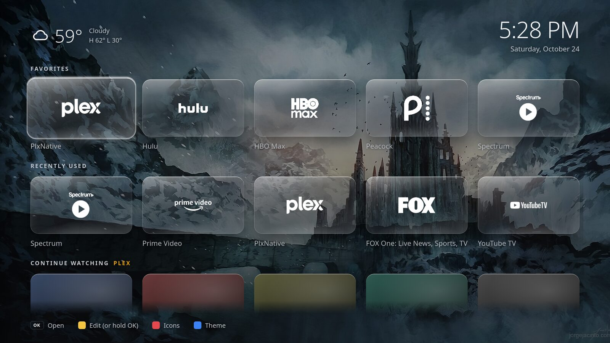
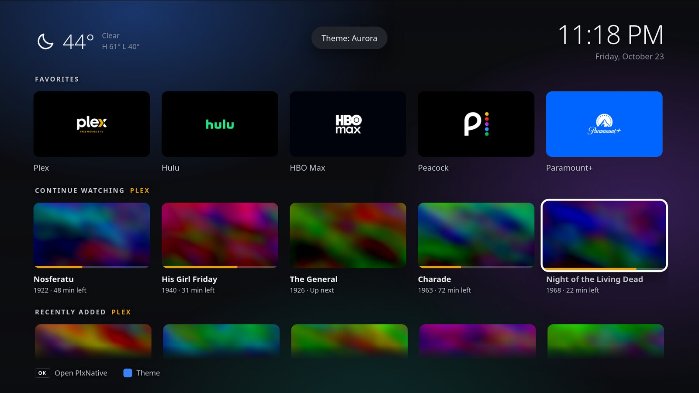
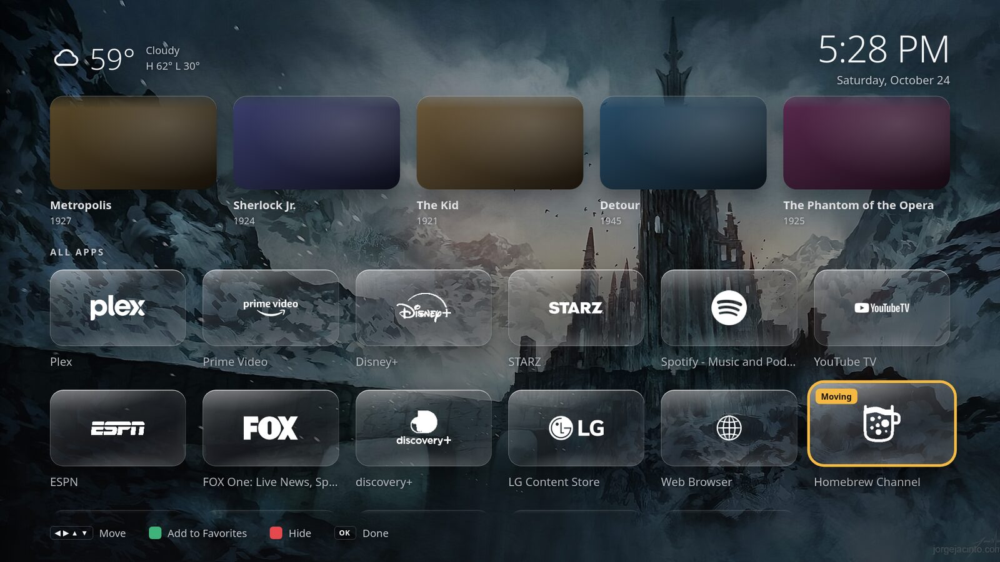
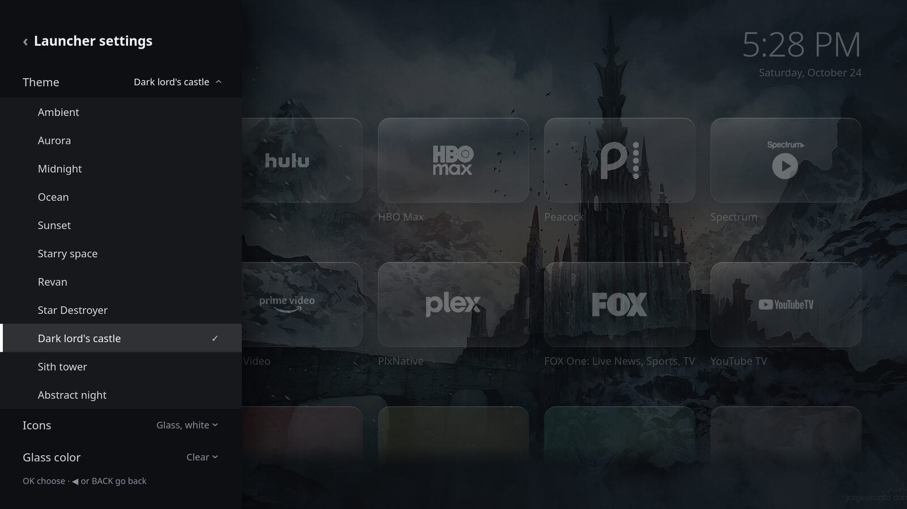

# webOS Launcher

A minimal home screen for LG webOS TVs, made for a stock TV in Developer Mode (webOS 5 and later). From the top:

- **Weather and clock** in the corner
- **Favorites**: a row of big tiles for the apps you use most
- **Recently Used**: your last few apps and inputs, wherever you opened them (rooted TVs)
- **Continue Watching**, **Watchlist** (rooted TVs) and **Recently Added** from your Plex server
- **All Apps**: everything else, which you can rearrange and hide
- **Inputs**: only the ones with something plugged in, named after the device when it says what it is
- **Themes**: **Ambient** (the focused app's color glows behind the grid), **Aurora** (slowly drifting colors), **Midnight** (plain dark), **Ocean**, **Sunset** and **Starry space** (painted landscapes that move slowly: rolling swells, drifting clouds, twinkling stars) and your own wallpapers, each a theme of its own (a picture or a looping video)
- **Icons**: the apps' own icons, or glass tiles with every logo in white, in its brand color or in ice blue, over any theme. The glass itself can be clear or tinted
- **Screensaver**: after a few idle minutes, a big clock and the weather over your own pictures and videos (all of them shuffled, or just the one you pick), or Plex artwork



| Plex rows | Editing an app |
| --- | --- |
|  |  |
| **The side menu** | **The screensaver** |
|  |  |

*Shown with a wallpaper of your own (here, a painting by Jorge Jacinto), the white glass icons and a screensaver of one picture. Screenshots are from the launcher's code running in a desktop browser at 1920×1080, with sample titles and artwork in place of a real Plex library.*

There's no build step. The app is plain HTML, CSS and JavaScript in `app/`, written for the Chromium 68 engine that webOS 5 runs.

## Controls

| Button | Browsing | Editing an app |
| --- | --- | --- |
| Arrows | Move around | Move the app (Favorites: left and right) |
| OK | Open the app, switch input, or open Plex from a Plex card | Done |
| Hold OK or Yellow | Edit the app or input | Done |
| Green | Show hidden apps, or leave them out again | Add to or remove from Favorites (inputs too) |
| Red | Next icon style | Hide or unhide |
| Blue | Next theme | |
| Back | Leave out hidden apps again | Done |
| Left on a row's first tile | Open the menu | |

Any button wakes the screensaver without doing anything else. The order, Favorites, hidden apps and theme are saved on the TV. The Magic Remote pointer also works: hover to focus, click to open.

## Setup

You need Node.js 20 or later on your computer, with the computer and TV on the same network.

### 1. Put the TV in Developer Mode

1. Create a free account at [webostv.developer.lge.com](https://webostv.developer.lge.com).
2. On the TV, install **Developer Mode** from the LG Content Store and sign in with that account.
3. Turn **Dev Mode Status** on and let the TV restart. Then open Developer Mode again and turn **Key Server** on. Keep the app open on screen for the next step.

### 2. Connect your computer

```sh
npm install
cp config.example.json config.json   # set tv.host to the TV's IP address
npx ares-setup-device -a tv -i "host=192.168.1.50" -i "port=9922" -i "username=prisoner"
npx ares-novacom -d tv --getkey      # needs Key Server on
npx ares-setup-device -m tv -i "privatekey=tv_webos" -i "passphrase=XXXXXX"   # the passphrase shown in Developer Mode
```

The sync step talks to the TV over LG's network API, the one phone remote apps use. Make sure **LG Connect Apps** is on. On webOS 5 it's under Settings → All Settings → Connection → Mobile Connection Management.

### 3. Sign in to Plex (optional)

```sh
npm run plex-login
```

This opens a Plex sign-in page in your browser. Once you approve it, the script picks your server, finds an address it can reach, and saves the address and token in `config.json`. If you'd rather do it by hand, fill in `plex.server` and `plex.token` yourself.

The script prefers your server's encrypted `plex.direct` address. If the Plex rows on the TV say they can't reach the server, the TV's older browser may not accept that certificate. In that case set `plex.server` to the plain address (e.g. `http://192.168.1.10:32400`) and rerun `npm run sync`. The token then crosses your network unencrypted.

### 4. Read your apps and install

```sh
npm run sync     # the TV asks once to allow the connection; accept it with the remote
npm run deploy   # packages the app, installs it and opens it
```

`sync` writes your apps, icons, inputs and settings into `app/data/`. After that the hourly updater (below) keeps it current.

### 5. Make it quick to reach

A stock TV won't let an app replace the Home button. Two things get close:

- **Pin it first.** Press Home, select the Launcher in the app bar, hold OK and move it to the front.
- **Quick Access** (on most LG remotes). With the launcher open, press and hold a number button on the remote (e.g. 1) to bind it. After that, holding 1 opens the launcher from anywhere.

## Settings in config.json

| Setting | What it does |
| --- | --- |
| `favorites` | The starting Favorites row, by app name. Once you change Favorites on the TV, the TV's choice wins. |
| `exclude` | Apps to leave out of the launcher entirely, by name (e.g. `["Music", "Sports Alert"]`). |
| `inputNames` | Names for inputs, by ID (e.g. `{"HDMI_1": "Xbox"}`). Otherwise the device's own name or the TV's label is used. |
| `showAllInputs` | `true` to show inputs with nothing plugged in. |
| `weather.zip` | The ZIP code for the weather. Leave `weather` out to hide it. `weather.units` is `fahrenheit` or `celsius`. |
| `screensaverMinutes` | Idle minutes before the screensaver starts (default 5); `0` turns it off. |
| `screensaverFolder` | A folder of your own pictures and videos for the screensaver, shown in random order, e.g. `"~/Pictures/Launcher screen savers"`. Pictures stay up 12 seconds; videos play through. Leave it empty to show Plex artwork instead. |
| `screensaverNames` | Names for the screensaver's files in the sidebar's picker, by file name, e.g. `{"IMG_0042.jpg": "Mountain lake"}`. Files without one are named after the file. |
| `relay.host` | The always-on computer that runs the phone remote's relay (`npm run relay-setup`), reached over SSH: a host, or `user@host`. |
| `relay.dir` | Where the relay goes on that computer, a path from the SSH user's home folder or an absolute one (default `tv-remote`). For a Docker manager such as Arcane or Dockge, its projects folder plus `/tv-remote`. |
| `tv.mac` | The MAC address of the TV's wired network port, for the relay to wake it. Read from the TV when it's left out. |
| `plex.appId` | The app the Plex cards open, by app ID. Defaults to the official Plex app; e.g. `"com.beb.plxnative"` for PlxNative. |
| `theme` | The starting theme: `ambient`, `aurora`, `midnight`, `ocean`, `sunset`, `space`, or a wallpaper's ID such as `wall-revan` (`wall-` and its name in lowercase, with dashes for spaces). Once you pick one with the blue button, the TV's choice wins. |
| `tiles` | Your own tile looks, keyed by app name or ID, or input ID: `title` (a new name), `bgColor`, `icon` (a picture; plain margins are trimmed), `removeBackground` (makes the icon's plain border see-through, for icons that come on a solid square), and for the glass icons `glassColor` (the logo's color) and `glassIcon` (a picture or `.svg` to use as its silhouette). E.g. `{"Netflix": {"bgColor": "#000000"}, "HDMI_2": {"icon": "media/tiles/spectrum-tv.png", "bgColor": "#ffffff"}}`. |
| `wallpapers` | Your own wallpapers, each a theme of its own: a list of `{ "name": "Revan", "file": "~/Videos/revan.mp4" }`. A file is a picture or a short looping video (`.mp4` or `.webm`); videos play silently. Keep videos short; the whole file goes onto the TV. The older single `wallpaper` (a file) still works, as a theme named Wallpaper. |

Pictures and videos for the wallpapers and screensaver are converted to 1080p (JPEG, or silent H.264 video) when they're synced; a wallpaper video that's already H.264 at 1080p or less goes as it is. Converted copies are kept in `media/cache`, so only new or changed files are converted again.

The updater picks up changes here, and files added to the screensaver folder, within the hour. To see them right away, run `npm run sync` and `npm run deploy`.

## Automatic updates

On a rooted TV the hourly run also updates the apps installed from the Homebrew Channel's official repository (`tools/app-updates.mjs`, or `npm run update-apps` by hand): each newer version is downloaded, checked against the repository's SHA-256, and installed over root SSH. An app that's on screen waits for the next run; the Homebrew Channel and its Updater update themselves. The launcher itself also reloads once a night, between 3 and 5 AM, while it's in the background or showing the screensaver.


`tools/auto-update.mjs` runs every hour from a systemd user timer. If the TV is on, it syncs. If anything changed since the last install (apps installed or removed, settings, or the launcher's own code), it reinstalls the launcher without opening it. When the launcher is on screen it waits for the next run, because reinstalling closes it.

```ini
# ~/.config/systemd/user/webos-launcher-update.service
[Unit]
Description=Update the TV launcher when the TV's apps or the settings change
Wants=network-online.target
After=network-online.target

[Service]
Type=oneshot
WorkingDirectory=%h/github/projects/webos-launcher
ExecStart=/usr/bin/node tools/auto-update.mjs
TimeoutStartSec=10min

# ~/.config/systemd/user/webos-launcher-update.timer
[Unit]
Description=Check the TV for launcher updates every hour

[Timer]
OnCalendar=hourly
RandomizedDelaySec=5min

[Install]
WantedBy=timers.target
```

```sh
systemctl --user enable --now webos-launcher-update.timer
journalctl --user -u webos-launcher-update   # what the last runs did
```

## On a rooted TV

With the Homebrew Channel's SSH server on, the tools install over root SSH instead of Developer Mode. Nothing expires, so the Developer Mode timer below isn't needed. **Uninstall the Developer Mode app before restarting a rooted TV**: if it's still installed at startup, the TV can delete every sideloaded app, the Homebrew Channel included.

```sh
ssh-keygen -t rsa -b 4096 -N "" -f ~/.ssh/tv_root   # once
npm run root-ssh                                   # installs the key, switches the tools to root SSH
npm run deploy
npm run install-ipk -- some-app.ipk                # any other webOS package
```

`root-ssh` logs in with the Homebrew Channel's default password the first time and installs the key. After the next restart the TV only accepts the key. It also sets `tv.root` in `config.json`, which makes `deploy`, `install-ipk` and the hourly updater use `scp` and the TV's installer service (`luna-send`) over SSH. LG's `ares-install` doesn't work here because the Homebrew Channel's SSH server refuses the second command it sends.

### TV-side hooks

`tv/init.d/` holds startup hooks for a rooted TV; `npm run tv-setup` copies them to `/var/lib/webosbrew/init.d/` and starts them, and installs `tv/bin/` and Input Hook's keybinds. The Homebrew Channel runs the hooks at every boot.

- `20-close-devtools-port`: closes the debug port (below).
- `40-launcher-helper`: starts `tv/helper/helper.js` (Node, root), which records which apps are on screen for the Recently Used row (`/home/root/.config/minimal-launcher/recent.json`), serves the phone remote, and runs the sleep timer and Night mode (below).
- `55-allow-admanager`: Life's Good Without Spying's "stop ad services" option swaps LG's ad manager (`/usr/sbin/admanager`) for a stub, and Disney+, ESPN and Peacock then hang on their loading screens. This hook removes just that stub at boot, and watches for a few minutes in case it comes back; the app's other blocks stay on. Pressing Apply in Life's Good Without Spying stubs it again: restart the TV or run `npm run tv-setup`. Its log is `/run/minimal-launcher/allow-admanager.log`.
- `50-watchdog`: every 5 minutes, starts the power-on watcher and the helper again if either has stopped. Its log is `/run/minimal-launcher/watchdog.log`.
- `30-launcher-on-wake`: opens the launcher when the TV is turned on with the remote (the TV reports why it turned on: `getPowerOnReason` says `remoteKey`), and for 20 seconds takes the screen back if a device woken with the TV grabs it over HDMI-CEC. When something else turned the TV on, such as a console over HDMI-CEC, it stays where that put it. Its log is `/run/minimal-launcher/launcher-on-wake.log`; `30-launcher-on-wake states` prints power states as they change.

### Commercial mute

`tv/bin/commercial-mute` toggles the TV's mute: muting starts a 2½-minute timer that unmutes it again, and a press while muted unmutes at once. It uses `com.webos.service.audio/master/muteVolume`, the mute the remote's button toggles (`com.webos.audio` has a separate one). Input Hook swallows a key it runs a command for, and kills what the command leaves behind, so the timer runs detached with `setsid`. `tv/lginputhook/keybinds.json` puts it on the remote's Mute button (code 113), next to Home and Exit → launcher (773 and 174), 1 → LG's home bar (2) and the dot → the sidebar (1038). `npm run tv-setup` installs both. To change the length, edit the `150` in the keybinds file.

### Menu

Pressing Left on the first tile of any row slides out a menu (Up/Down to move, OK or Right to choose, Back or Left to go back):

- **Inputs**: switch straight to one.
- **Picture & sound** (rooted TVs): the picture mode and sound mode of the apps and of each input (LG keeps one of each per input), from the modes the TV offers.
- **Sleep timer** (rooted TVs): 30, 60, 90 or 120 minutes, with a TV notification a minute before. The helper on the TV runs it, so it works whatever app is on screen.
- **Launcher settings**: theme, icons, the glass color (with glass icons on), Night mode, when the screensaver starts and what it shows, a button to start it now, 12- or 24-hour clock, °F or °C, showing hidden apps. Saved with the layout backup.
- **HDMI settings** (rooted TVs): per input, Deep Color (needed for 4K HDR at full quality) and PC mode; and SIMPLINK (HDMI-CEC) and Auto Power Sync for the whole TV. These are the TV's own settings, read and changed through `com.webos.settingsservice` as root.
- **System**: LG's settings app; turning the TV off and rebooting it, each after a second OK. Turning off darkens the screen at once (`tv/bin/power-off` switches the panel off, then powers the TV down), so it feels as quick as the remote's power button.

### Night mode

From the hour picked in Launcher settings (9, 10 or 11 PM, or midnight) until 7 AM, the launcher dims itself, the screensaver included. On a rooted TV the helper also turns on the TV's Eye Comfort Mode (warmer colors) and sets energy saving to medium (a dimmer screen), whatever is on screen, and in the morning puts back what they were before. Both are TV-wide settings. While night mode is on, the earlier values are kept in `/home/root/.config/minimal-launcher/night.json`.

### Phone remote

The helper serves a remote control page on port 8765 for phones on the home network: a D-pad with OK and Back, Home (the launcher), LG's home bar, volume, the commercial mute, play controls, power, and your apps and inputs. Buttons go through the TV's own network remote service, using the client key the computer was approved with. `npm run tv-setup` prints a private link (`http://<tv>:8765/?k=…`): opening it once on a phone saves the key in a cookie, and the page refuses anyone without it.

**Turning the TV on from the phone**: the page lives on the TV, and a TV that's off soon stops answering on the network, so on its own the page can only turn the TV off. The relay in `relay/` fixes that. It runs on an always-on computer on the home network that has Docker (a home server or NAS), and serves the same page on the same port, passing everything through to the TV. When the TV is off it still loads the page (showing "TV is off"), and the power button wakes the TV with a Wake-on-LAN packet. For that, the TV's **Mobile TV On** setting must be on (Settings → All Settings → General → Mobile TV On, "Turn on via Wi-Fi"), and the TV should be on a wired connection. Set `relay.host` in config.json, then, with the TV on:

```sh
npm run relay-setup
```

It copies the relay to that computer over SSH, with the TV's address, its MAC address and the remote's key, starts it with Docker Compose, and prints the relay's private link (`http://<server>:8765/?k=…`, the same key as the TV's). If your SSH user can't run Docker there, it says how to start it (with sudo, or as the `tv-remote` project in a Docker manager such as Arcane or Dockge: point `relay.dir` at its projects folder). Run it again after changing `relay/`; changes to the page reach the relay by themselves.

**Type on the TV**: with a text box open on the TV (one that brings up LG's own keyboard, as the web browser and many apps do), what you type on the phone appears there as you type, and Enter submits it. Apps that draw their own keyboard, such as YouTube and most streaming apps, don't take it, so two buttons search directly: **Search YouTube** opens YouTube's results for the text, the way a voice search does, and **Search Plex** lists matching movies, shows and episodes from your server on the phone, with posters; tap one to open its page in PlxNative on the TV (with `plex.appId` set to another Plex app, that app just opens). The helper runs the Plex search, so the server's token never reaches the phone.

### Plex Watchlist

The hourly sync reads your Watchlist from plex.tv, matches each title on your server, and writes the list to `/home/root/.config/minimal-launcher/watchlist.json` on the TV, so a Watchlist change doesn't need a reinstall. Titles on the server open their page in PlxNative; the rest are marked as not on it.

### Layout backup

On a rooted TV the launcher copies its order, hidden apps, Favorites and theme to `/home/root/.config/minimal-launcher/layout.json` (through the Homebrew Channel's root service) whenever they change. A fresh install restores them from there. `sync` also keeps a copy in `backup/layout.json` and packages it, for when the TV itself was reset.

### Opening Plex titles

With `plex.appId` set to PlxNative, a Continue Watching card resumes that title, and a Recently Added card opens its page, using [PlxNative's launch links](https://github.com/GLinnik21/plx-native). On webOS before 7.4 a link only works on a cold start, so the launcher closes PlxNative first.

### Closing the debug port

webOS opens the web app manager's remote debugging port (9998) on every network interface. On a rooted TV it lets anyone on the network script the Homebrew Channel, which has root. The kernel has no firewall, so a startup hook in `/var/lib/webosbrew/init.d/20-close-devtools-port` bind-mounts a copy of `/etc/systemd/system/scripts/webapp-mgr.sh` without `--remote-debugging-port` and restarts the web app manager. (`--remote-debugging-address=127.0.0.1` was tried first; the web app manager ignores it.) To reopen the port for debugging until the next restart:

```sh
umount /etc/systemd/system/scripts/webapp-mgr.sh && systemctl restart webapp-mgr
```

### Home button

[LG Input Hook](https://github.com/Simon34545/lginputhook), a root-only app from the Homebrew Channel, can make the remote's Home button open the launcher. Install it, open it once (that starts it, and it then starts itself at boot), and put this in `/home/root/.config/lginputhook/keybinds.json` on the TV:

```json
{
  "773": {"action": "launch", "id": "com.minimal.launcher"},
  "174": {"action": "launch", "id": "com.minimal.launcher"},
  "2": {"action": "launch", "id": "com.webos.app.home"},
  "1038": {"action": "exec", "command": "/home/root/minimal-launcher/bin/launcher-sidebar"}
}
```

773 is Home on LG's infrared remotes (checked on an AKB75675313) and 174 is Exit; both open the launcher, so leaving an app or the TV's settings lands on the launcher instead of live TV. Pressed on the launcher itself, either one goes back to the top of the home screen and closes the sidebar. 2 is the **1** button; it opens LG's own home bar (`com.webos.app.home`) as a fallback. 1038 is the **.** (dot) button; `tv/bin/launcher-sidebar` launches the launcher with its sidebar open from anywhere, and on the launcher it opens or closes the sidebar. Input Hook reloads the file when it changes. To find another button's code, open Input Hook and watch its log while pressing the button. Don't press "Save changes" in Input Hook's own screen unless it shows your keybinds, because it overwrites the file with what it shows.

## Keeping Developer Mode alive

When the Developer Mode session runs out, **the TV deletes the launcher**. Current versions of the Developer Mode app give 1000 hours; older ones gave 50. To reset it, press Extend in the Developer Mode app or run:

```sh
npm run extend-devmode
```

The first run has to reach the TV. It saves the session token in `config.json`, and later runs use the saved token when the TV is in standby. To run it daily, add a timer like the one above, with `OnCalendar=daily`, `Persistent=true` and `ExecStart=/usr/bin/node tools/extend-devmode.mjs`.

User timers only run while you're logged in. `Persistent=true` catches up on a missed run at the next login. Otherwise, run `loginctl enable-linger` so timers run without a login.

## What it can't do

- **No Continue Watching for Netflix, YouTube, Disney+, Prime Video and similar apps.** webOS doesn't let one app read another's data, and those services have no public API for it. Plex works because your server has one.
- **Plex cards open the Plex app, not the title itself.** There's no documented way to tell Plex for LG which item to play from another app.
- **The Home button can't be remapped** on a stock TV. See Quick Access above.
- **The screensaver only runs on the launcher.** The TV's own screensaver and power settings still apply everywhere else.

## Layout

```
app/          the TV app: index.html, style.css, main.js, luna.js, plex.js, weather.js, scenes.js
app/data/     written by `npm run sync`; not in git (it holds your Plex token)
tools/        sync, auto-update, deploy, plex-login and extend-devmode
relay/        the phone remote's relay, for a home server (Docker Compose)
tools/glass-icons/  silhouettes drawn for the glass icons; most come from Simple Icons
config.json   your TV address and settings; not in git
dist/         the built package and a fingerprint of what's installed
```

To preview in a desktop browser, open `app/index.html` with the window at 1920×1080. Use Enter, the arrow keys, Esc for Back, and R, G, Y and B for the color buttons.

## License

MIT. See [LICENSE](LICENSE). The glass icons' logos come from [Simple Icons](https://simpleicons.org) (CC0); the brands are their owners' trademarks.
